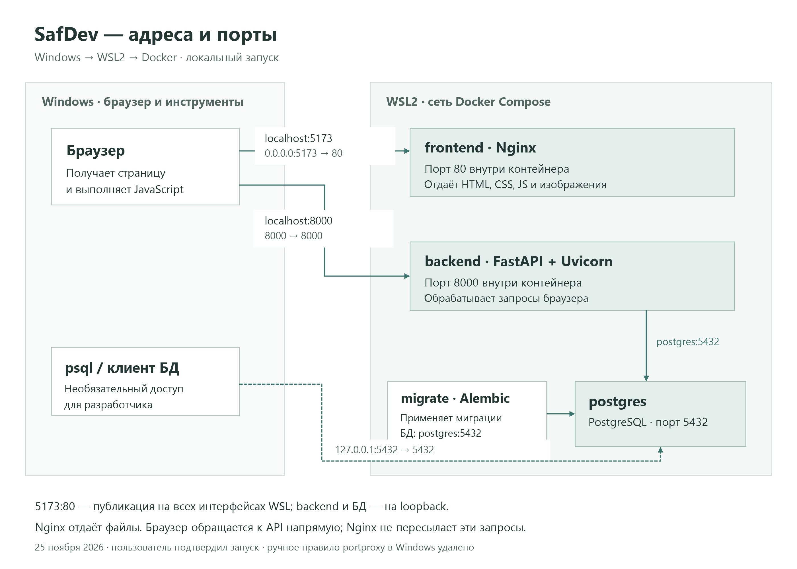

# SafDev

A messenger project built with React, TypeScript, FastAPI and PostgreSQL.
Authentication uses server-side sessions and HttpOnly cookies. The chat currently
uses mock contacts and local messages that reset on page reload.

## Run with Docker

Requires Git and a running Docker Engine with Docker Compose, or Docker Desktop.
Python and Node.js do not need to be installed on the host for this option.

1. Clone the repository:

   ```bash
   git clone https://github.com/dalerjig/SafDev.git
   cd SafDev
   ```

2. Create `.env` next to `compose.yaml` and replace the password placeholder:

   ```dotenv
   POSTGRES_DB=safdev
   POSTGRES_USER=safdev_user
   POSTGRES_PASSWORD=replace-with-your-own-local-password
   ```

   Keep this file private. If you already have a database volume, keep its existing credentials.

3. From the repository root, start the project:

   ```bash
   docker compose up --build
   ```

   Compose starts PostgreSQL, waits for it to accept connections, applies Alembic
   migrations, starts the API and serves the built frontend through Nginx.
   On a new machine, PostgreSQL creates a separate database using your `.env`.
   The `migrate` container exiting with code 0 is expected.

4. Open **http://localhost:5173**. API documentation is at **http://localhost:8000/docs**.

Stop any separately running development servers on ports 5173 and 8000 before
starting the Docker stack. Use `localhost` consistently: the browser's API URL is
currently `http://localhost:8000`.

To stop everything, press `Ctrl+C`, then run `docker compose down` if you also
want to remove the stopped containers. The database stays in `postgres_data`.
Do not add `-v` unless you intend to delete the database volume and its data.

To run in the background, use `docker compose up --build -d`. View status with
`docker compose ps -a`. For startup errors, use `docker compose logs migrate backend`.
After changing code, run `docker compose up --build` again; this setup does not use hot reload.

## Run application servers without Dockerfiles

For development, keep only PostgreSQL in Docker and run Python and Vite locally.
The following commands use Bash on Ubuntu or WSL and assume the checkout is at
`~/SafDev`. Requires Python 3.12 with venv support and Node.js from `Frontend/.nvmrc`.
The Node.js commands below assume nvm is installed.

Start the database from the repository root:

```bash
cd ~/SafDev
docker compose up -d postgres
```

Wait for the database to become ready before applying migrations. You can check with:

```bash
docker compose exec postgres sh -c 'pg_isready -U "$POSTGRES_USER" -d "$POSTGRES_DB"'
```

Set up and run the backend in one terminal:

```bash
cd ~/SafDev/Backend
python3.12 -m venv .venv
source .venv/bin/activate
python -m pip install -r requirements.txt
alembic upgrade head
python -m uvicorn app.main:app --reload --host 0.0.0.0 --port 8000
```

If Ubuntu reports missing `ensurepip`, install `python3.12-venv` with apt and
repeat the environment creation. For later runs, activate the existing environment;
do not recreate it. Apply new migrations after pulling schema changes.

Set up and run the frontend in another terminal:

```bash
cd ~/SafDev/Frontend
nvm install
nvm use
npm ci
npm run dev -- --host 0.0.0.0 --port 5173 --strictPort
```

Open **http://localhost:5173**. On later runs, reinstall dependencies only when
they change. Stop local servers with `Ctrl+C` and the database with
`docker compose stop postgres`. Stop Docker's frontend/backend containers before
switching to this mode so the ports are available.

## Try the application

Register with a display name and a password of 10–128 characters. Save the generated
six-digit public ID, then use it to log in. Registration does not automatically
log you in. An initial `401` from `/auth/me` is normal without an active session.

Authentication data persists in PostgreSQL; the demo chat history does not.
Changing `.env` credentials does not reconfigure an already initialized database.
This setup is for local use; HTTPS and deployment configuration are separate steps.

## Local network



[Scalable SVG diagram](NETWORK.svg).
